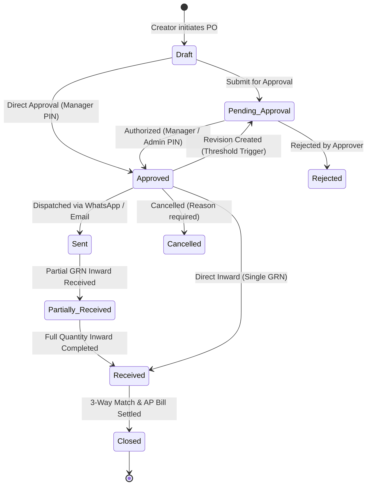

# Enterprise Purchase Order Workflow & Procurement Architecture

## Overview
This document outlines the architecture, data schema, mathematical engines, maker-checker authorization controls, and end-to-end lifecycle for Purchase Orders in the ICC Computer & Electronics ERP system.

---

## 1. Core Problems Solved
1. **Multi-Line Item Table & Product Picker**: Replaced the legacy single-row free-text SKU input with an interactive multi-line table equipped with real-time catalog search (Name, SKU, Barcode, Brand, Model), master inventory linkage, and keyboard-friendly navigation.
2. **Deterministic Financial Math & Nepal 13% VAT**: Integrated live calculating summaries for Subtotal, Discounts, Net Taxable Amount, 13% Nepal VAT, and Other Charges (freight, customs, insurance), with zero float-precision loss using integer Paisa arithmetic.
3. **Dual Calendar Engine (BS & AD)**: Native support for Nepali Bikram Sambat (BS) and Gregorian (AD) dates with a one-click toggle, accurate fiscal year mapping (Shrawan 1 to Ashadh 32/31), and delivery date validation.
4. **Clean Input Defaults**: Eliminated hardcoded quantities (10) and costs (1000). Fields initialize empty or dynamically prefill with suggested safety-stock replenishment quantities and last purchase cost.
5. **PO Numbering & Location Metadata**: Transaction-safe, gapless sequential numbering per fiscal year (`PO-YYYY-YY-XXXX`) allocated server-side, alongside deliver-to locations, payment terms, currency/forex conversions, internal notes, and supplier quotations.
6. **Maker-Checker Authorization Matrix**: Role-based threshold approvals with PIN verification, revision snapshotting, and tamper-evident audit logging.

---

## 2. Status Lifecycle & Workflow Transitions

### Status Descriptions:
- **Draft (`draft`)**: Editable procurement draft saved by Purchase Officer.
- **Pending Approval (`pending_approval`)**: Locked for editing; awaiting supervisor review.
- **Approved (`approved`)**: Authorized with PIN; recorded in `po_approvals` with approver, device, and timestamp.
- **Sent (`sent`)**: Dispatched to supplier via tracked WhatsApp or Email link.
- **Partially Received (`partially_received`)**: First delivery shipment received via GRN screen.
- **Received (`received`)**: 100% ordered units received into warehouse inventory.
- **Closed (`closed`)**: 3-Way matching completed against supplier tax invoice and Accounts Payable ledger.
- **Cancelled (`cancelled`)**: Voided order with recorded justification.

---

## 3. Mathematical Formulae & Tax Rules

### Line Net & 13% VAT Calculation
$$\text{Base Amount} = \text{Quantity Ordered} \times \text{Unit Cost}$$
$$\text{Discount Amount} = \frac{\text{Base Amount} \times \text{Discount } \%}{100}$$
$$\text{Net Taxable} = \text{Base Amount} - \text{Discount Amount}$$
$$\text{Line VAT (13\%)} = \begin{cases} \text{Round}(\text{Net Taxable} \times 0.13) & \text{if Tax Category} = \text{vat\_13} \\ 0 & \text{if Exempt} \end{cases}$$

### Landed Cost Apportionment (Freight & Customs)
Other charges (freight, customs handling, transit insurance) are apportioned across line items based on net value ratio:
$$\text{Apportioned Charge} = \frac{\text{Line Net Taxable}}{\sum \text{Net Taxable}} \times \text{Other Charges}$$
$$\text{Landed Cost Per Unit} = \frac{\text{Line Net Taxable} + \text{Apportioned Charge}}{\text{Quantity Ordered}}$$

### Expected Gross Margin %
$$\text{Gross Margin } \% = \frac{\text{Retail Selling Price} - \text{Landed Cost Per Unit}}{\text{Retail Selling Price}} \times 100$$
*Items with expected margin $< 10\%$ trigger visual warning badges.*

### Price Variance Detection
$$\text{Price Variance } \% = \frac{\text{Current Unit Cost} - \text{Last Purchase Cost}}{\text{Last Purchase Cost}} \times 100$$
*Price variance $\ge 10\%$ triggers an amber warning badge.*

---

## 4. Maker-Checker Approval Matrix
| PO Amount Threshold | Authorized Role | Required PIN | Maker-Checker Rule |
| :--- | :--- | :--- | :--- |
| **< NPR 1,00,000** | Purchase Officer / Manager | Optional / Auto | Self-approval allowed for minor supplies |
| **NPR 1,00,000 – 5,00,000** | Store Manager (`manager`) | `1234` | Creator cannot approve their own PO |
| **> NPR 5,00,000** | System Admin (`admin`) | `9999` | Strictly executive authorization |

---

## 5. Phased Delivery Breakdown

### Phase 1: Multi-line PO, Product Picker, Totals/VAT, Gapless PO Numbering
- **What Changed**:
  - Upgraded [`lib/procurement/po-calculator.ts`](file:///c:/Users/somth/Downloads/icc-eweb/lib/procurement/po-calculator.ts) for deterministic integer Paisa arithmetic.
  - Upgraded [`lib/procurement/po-validation.ts`](file:///c:/Users/somth/Downloads/icc-eweb/lib/procurement/po-validation.ts) with strict Zod validation schemas.
  - Implemented [`components/admin/CreatePurchaseOrderModal.tsx`](file:///c:/Users/somth/Downloads/icc-eweb/components/admin/CreatePurchaseOrderModal.tsx) with search picker, BS/AD date toggle, live summary, and keyboard shortcuts.
- **How to Test**:
  - Run `npx tsx scripts/test-po-full-workflow.ts`
  - Open Storekeeper Dashboard $\rightarrow$ Click "Create Purchase Order" $\rightarrow$ Pick products $\rightarrow$ Observe live totals, VAT, and landed costs.

### Phase 2: Workflow Lifecycle, Approval Matrix with PIN, Revisions, Audit Log
- **What Changed**:
  - Implemented transactional database tables: `purchase_order_revisions`, `po_approvals`, `po_attachments`, `po_communications`, `supplier_terms`.
  - Upgraded `POST /api/admin/inventory/purchase-orders` with supervisor PIN verification, duplicate order protection, and revision snapshotting.
- **How to Test**:
  - In PO Modal, click "Approve & Issue (PIN)" $\rightarrow$ Enter PIN `1234` for Manager or `9999` for Admin $\rightarrow$ Verify authorization timestamp and approver name in PO card.

### Phase 3: A4 Printable PDF, WhatsApp/Email Dispatch, Low-Stock Grouping
- **What Changed**:
  - Built [`components/admin/PurchaseOrderPrintModal.tsx`](file:///c:/Users/somth/Downloads/icc-eweb/components/admin/PurchaseOrderPrintModal.tsx) with company PAN (601298453), supplier details, line table, QR token, and signature stamp.
  - Added "Auto-PO from Low Stock" button in dashboard to automatically group low-stock items by preferred vendor.
- **How to Test**:
  - Click "Print / PDF" on any PO card $\rightarrow$ Review clean A4 white canvas with QR verification $\rightarrow$ Enter phone number and click "Send".

### Phase 4: GRN Receiving Linkage, 3-Way Match & Committed Spend
- **What Changed**:
  - Clicking "Receive Inward" on an approved PO automatically prefills the Inward GRN form (`purchaseOrderId`, `supplierId`).
  - Added committed spend metrics (`openPosCount`, `committedSpendAmount`) to API to feed cash-flow forecasting.
- **How to Test**:
  - On any approved PO $\rightarrow$ Click "Receive Inward" $\rightarrow$ Verify GRN modal opens with PO linked $\rightarrow$ Scan or enter serials and post GRN.
